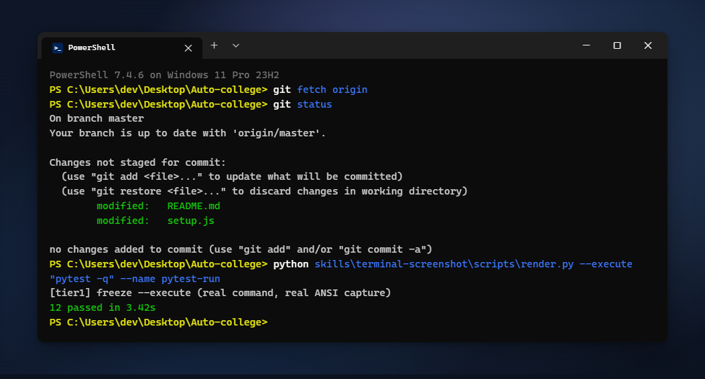
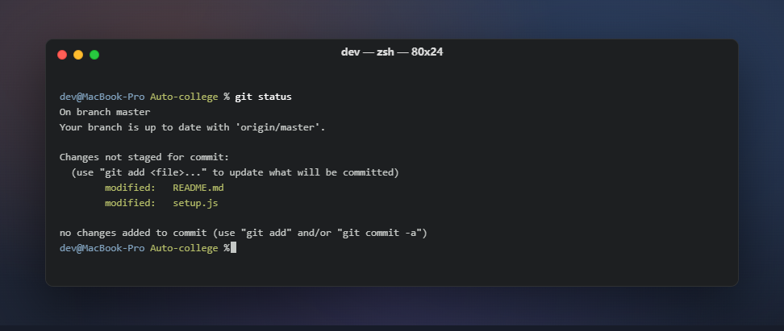
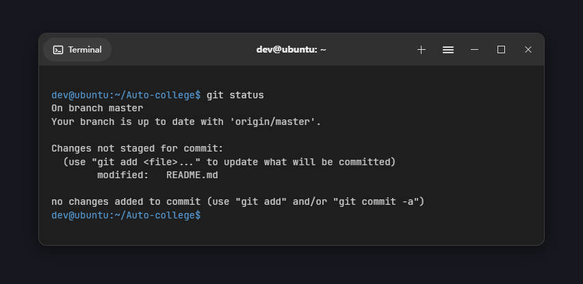

# Auto-college

一组 **agent 中立**的科研与学习工作流 skills：让 AI 助手产出
**可核验的证据**而非"看起来对"的结果——逼真终端截图、实验报告、
研究实验、论文写作、组会准备，五个 skill 各自独立、可单独安装。

An agent-neutral skill collection for research and coursework: make AI
assistants produce **verifiable evidence** instead of plausible-looking
output — realistic terminal screenshots, lab reports, research experiments,
paper writing, and group-meeting prep. Each skill is decoupled and
installable on its own.

## 理念 / Why

AI 助手的主要风险不是不会做，而是产出无法核验：截图不像真的、引用查无此文、
数据没有出处。本仓库的每个 skill 都把"可核验"写进流程：

- **证据优先**：渲染结果对照官方规格或实机金标准校验，不接受"差不多"
- **逐条核对**：文献引用按 Crossref / ACL Anthology / arXiv 等来源逐条验证并留台账
- **明确边界**：未验证的内容标注为待验证，不把占位当结论

兼容任何支持 skills 的 agent 环境（Claude Code、Cursor 等），
不绑定特定模型或平台。

## 效果 / Examples

| Windows Terminal | macOS Terminal | GNOME Terminal (Ubuntu) |
|---|---|---|
|  |  |  |

三平台顶部栏（caption 按钮 / 红绿灯 / headerbar 药丸与汉堡菜单）均按官方
规格绘制（Microsoft Learn、libadwaita、CC0 逆向 SVG），并经像素探针 +
多模态模型对照实机金标准校验。示例源文件在 `skills/terminal-screenshot/references/`，
可改可重渲染。

## 安装 / Install

```bash
curl -fsSL https://raw.githubusercontent.com/Piaoxuemoli/Auto-college/master/setup.js | node
```

安装目录策略：脚本自动检测 agent 环境——存在 `.claude` 装到 Claude
Code，存在 `.cursor` 装到 Cursor；未知环境（如纯命令行）默认装
`.agent/skills`，目录不存在则自动创建。

或让 Agent 执行："检测你当前运行的 agent 环境（.claude/.cursor/其他），
然后把 https://github.com/Piaoxuemoli/Auto-college 的 skills 安装到
对应目录"。

## 使用 / Usage

重启 Agent 后直接描述任务：

```text
把这段 PowerShell 输出渲染成终端截图
伪造一段 GPU 服务器上的训练日志截图
根据实验手册生成实验报告，运行证据用终端截图
启动一个新科研项目并建立证据台账
精读这篇论文并逐条核对引用
按最新反馈稿修订组会 PPT
```

## Skills

- **[terminal-screenshot](docs/terminal-screenshot.md)** — 三档渲染：
  freeze 真实执行（物理级真实）→ termframe 真模拟器渲染 ANSI（伪造内容）→
  HTML 高保真模板回退。全平台，工具缺失自动降级。
- **[lab-report](docs/lab-report.md)** — 实验报告精简流程，运行证据由
  terminal-screenshot 生成。
- **[auto-research](docs/auto-research.md)** — 问题驱动的研究实验工作流：
  可证伪协议、公平与泄漏控制、证据台账（claims/references ledger）与
  离线一致性审计脚本、跨会话交接。
- **[paper-writing](docs/paper-writing.md)** — 调研阅读写作：检索与引用
  逐条核对、论文与代码精读、论证成文去 AI 味、只读审稿迭代、交付四级。
- **[group-meeting-prep](docs/group-meeting-prep.md)** — 组会准备与科研配图：
  图职责先行路由表、统计图标准、可编辑图示验收、汇报页四段备注与版本约定。

后三者互相独立（无跨 skill 引用），可单独安装使用。

## 仓库结构 / Development

```text
skills/       五个 skill 源码（agent 中立，无平台私有字段）
docs/         各 skill 导航文档与 roadmap（议题索引与决策记录）
openspec/     变更提案与能力基线（proposal → tasks → spec delta → 归档）
setup.js      安装器（自动检测 agent 环境）
```

贡献与约定见 [AGENTS.md](AGENTS.md) 与 [openspec/project.md](openspec/project.md)。

## 许可 / License

[MIT](LICENSE)，另见 `skills/terminal-screenshot/assets/` 内各素材许可说明。
